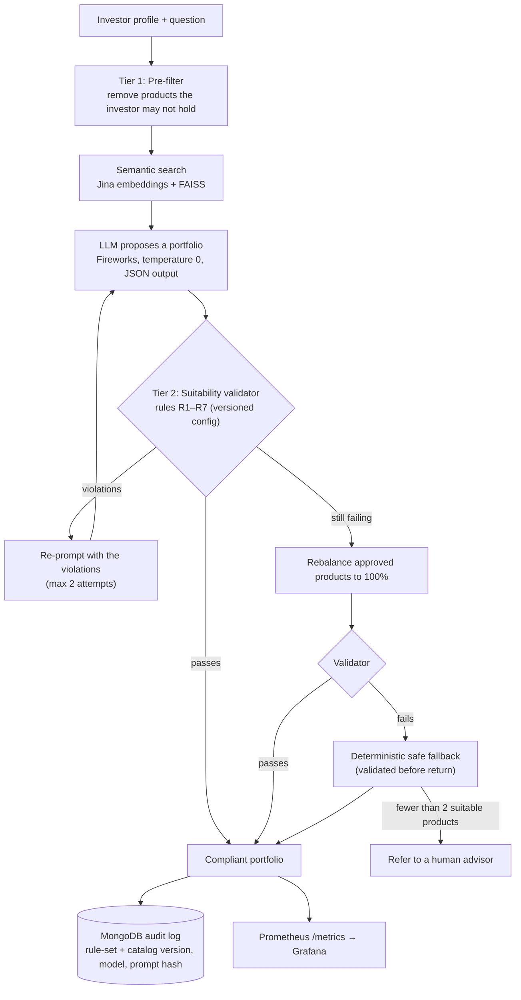
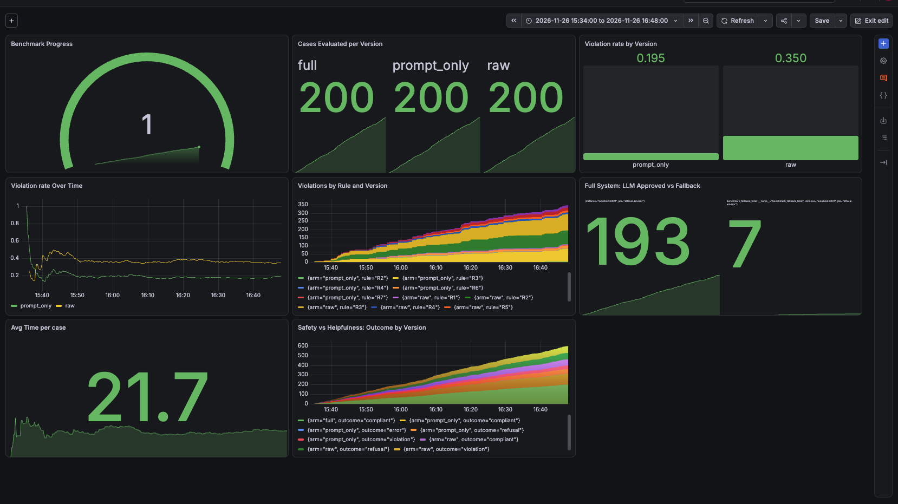

# Ethical AI Investment Advisor

An LLM-powered investment advisor where **the LLM proposes and deterministic rules decide**.
Every recommendation is checked against investor-specific suitability rules before it reaches
the user, and every decision is logged with the rule-set and catalog version that produced it.

---

## Why this project

LLMs are good at personalising financial advice, but they do not reliably follow rules. An LLM can
recommend a 3x leveraged ETF to a 72-year-old beginner, and in a regulated industry that is a
compliance failure, not just a bad answer. Writing the rules into the prompt helps, but it is a
request, not a guarantee.

This project treats the LLM as an **untrusted component**, the same way a trading system treats a
strategy: the strategy can propose any order, but a pre-trade risk check decides what reaches the
market. Here, a suitability validator plays that role.

---

## Architecture



- **The LLM never has the final say.** Every path out of the advisor, including re-prompts,
  rebalancing and the fallback, goes through the same validator.
- **Rules live in one versioned file**, [`config/suitability_rules.json`](config/suitability_rules.json),
  shared by the pre-filter and the validator, so the two can never disagree.
- **Every decision can be traced**: the audit record stores the rule-set version, catalog version,
  model, temperature and a hash of the prompt.
- **Input scope guard** (LLM classifier, fails open) rejects non-investment requests before retrieval;
  not part of the benchmark, which uses investment queries only.
- **`GET /rules`** serves the active R1–R7 definitions from the rules file; the dashboard's compliance
  log is built from it, so the UI always shows the rules the validator actually enforces.

---

## Benchmark results

The benchmark compares three versions of the system on the same 200 investor-and-question pairs:

1. **Raw LLM**: a neutral prompt with the investor profile and products, and no rules.
2. **Rules in the prompt**: the same information plus every rule that applies to the investor, but nothing checks the answer.
3. **Full system**: pre-filter, rules in the prompt, validator, re-prompt, rebalance and fallback.

Each answer is classified as **compliant**, **violation**, **refusal** (the LLM said nothing fits),
**referred** (to a human advisor) or **error**. Violation rate = violations ÷ (cases − errors).

| Version | Violation rate (95% CI) | Compliant | Violation | Refusal | Error |
|---|---|---|---|---|---|
| Raw LLM | **35.0% ± 6.5** | 63 | 70 | 67 | 0 |
| Rules in the prompt | **19.6% ± 5.5** | 111 | 39 | 49 | 1 |
| Full system | **0.0% ± 0.9** | **200** | 0 | 0 | 0 |

- **Full system:** 193 of 200 portfolios (96.5%) came from the LLM, after re-prompting where needed;
  7 (3.5%) used the safe fallback; none had to be referred to a human.
- **When a compliant answer was possible** (162 cases with at least 2 suitable candidates):
  raw 34.6%, rules in the prompt 11.2%, full system 0%.
- **All 600 answers came from the same primary model**, so the comparison is like for like.

**Key findings**

1. **Prompting helps but does not reach zero.** Writing the rules into the prompt cut violations
   from 35% to about 20%, and to about 11% when good options existed.
2. **The LLM follows categorical rules, not numeric limits.** With the rules in the prompt,
   R2 violations (time horizon, liquidity, objective) fell from 85 to 2, beginner violations (R5)
   from 11 to 0, and no leveraged ETF was recommended (R1). But 34 of the 39 violating cases broke
   only the **numeric** limits: product risk within tolerance + 1 and the weighted-risk cap (R3),
   and the 60% single-product cap (R6). Arithmetic constraints belong in code, not in a prompt.
3. **Guardrails make the system safer *and* more helpful.** The raw LLM refused a third of
   requests and still broke rules in another third. The full system returned a compliant,
   usable portfolio for all 200 investors.
4. **For seniors (65+), prompting did not help** (28.3% raw vs 33.3% with rules in the prompt;
   the intervals overlap). The raw LLM tended to refuse risky senior requests, while the
   prompted version tried to answer and slipped on the numeric limits.

**Caveats**

- It is a **stress test**: many questions deliberately push against the rules, and the sample is
  weighted towards seniors, beginners and short horizons, so real-world rates would be lower.
- Investors are synthetic, and results are for one model (`deepseek-v4p1-flash` on Fireworks).
- Temperature 0 reduces randomness but does not make hosted LLMs fully deterministic.
- The full system's 0% is guaranteed by design, because the validator is the gate. The evidence
  that matters for it is the usable-portfolio rate and the share of portfolios that came from the
  LLM, plus the validator's own unit tests.

Full results: [`data/benchmark_comparison.txt`](data/benchmark_comparison.txt),
[`data/violation_rate_report.json`](data/violation_rate_report.json) (every case and answer),
[`data/benchmark_all_answers.txt`](data/benchmark_all_answers.txt).

### Live monitoring during the benchmark



---

## Suitability rules

Each rule category is tied to a factor that US suitability rules require advisors to consider.
The exact thresholds are **firm policy**: regulators do not publish numbers like these.

| Rule | What it checks | Source of the factor |
|---|---|---|
| R1 | No leveraged or inverse ETFs for long-term advice | FINRA Notices 09-31 and 12-03 |
| R2 | Time horizon, liquidity needs and capital-preservation objective | Reg BI care obligation; FINRA 2111 factors |
| R3 | Product risk within tolerance + 1, and a cap on weighted portfolio risk | Reg BI care obligation; FINRA 2111 risk tolerance |
| R4 | Risk caps for senior investors (65–69 and 70+) | Reg BI care obligation; FINRA 2111 age factor |
| R5 | Beginners: no complex, alternative or futures-based products | FINRA Notice 12-03; Reg BI care obligation |
| R6 | Diversification: single-product and asset-class caps | Firm policy |
| R7 | High-risk exposure capped relative to investable assets | Reg BI care obligation; FINRA 2111 financial situation |

Rule set version: `rules-v2.0.0`.

---

## Data

**Products: 198 real US ETFs** fetched from Yahoo Finance (`yfinance`).

- Risk scores are **calculated, not assigned**: annualised volatility from 5 years of adjusted daily
  prices, mapped to 5 levels (cut-offs at 5%, 10%, 20% and 40%). The method is inspired by the
  EU's SRRI but uses 5 levels so it matches the investors' 1–5 risk tolerance scale; under SRRI's
  7 bands, most of this catalog would crowd into levels 6 and 7.
- Leveraged and inverse funds are detected from the fund category first (with a precise regex
  backup) and are always risk 5.
- Funds with less than 3 years of history are excluded.
- Each product stores provenance: fetch time, data source, risk-method version and catalog version.

**Investors: 5,500 synthetic profiles** (`synthetic-v2`, fixed seed 42).

- Realistic, noisy relationships between age, income, investable assets, experience, time horizon,
  risk tolerance, objective and liquidity needs.
- Ten deliberate edge cases (for example, a 75-year-old with risk tolerance 5, and investors
  exactly at the age boundaries 64, 65, 69 and 70).
- Contradictory profiles are flagged in `profile_warnings` rather than silently resolved.
- The investor's name is never sent to the LLM.

Full schemas: [`docs/schemas.md`](docs/schemas.md).

---

## Tech stack

Python · FastAPI · Pydantic · MongoDB · FAISS · Jina embeddings · Fireworks AI · yfinance ·
Prometheus · Grafana · pytest · Locust

---

## Project structure

```
app/
  core/            config, MongoDB access, cache, audit logger
  schemas/         Pydantic models (investors, products, recommendations)
  services/        validator, RAG advisor, LLM client, embedder, vector store
  static/          web dashboard and the Grafana dashboard JSON
  main.py          FastAPI app (UI, REST API, /metrics)
config/
  suitability_rules.json          versioned rule set (R1–R7)
scripts/
  ingest_data.py                  fetch ETFs, generate investors, build the FAISS index
  measure_violation_rate.py       3-version benchmark
  counterfactual_fairness_test.py name-sensitivity test
  ...                             load tests, API checks, DB management
tests/             unit tests for every rule boundary and failure path
data/              FAISS index, benchmark results, dashboard screenshot
docs/              data schemas
prometheus.yml     scrape config for the app (:8000) and the benchmark (:8001)
```

---

## Limitations and next steps

- Rules check the investor's **profile**, not what the user asks for: "a down payment in 2 years"
  from someone whose profile says a 21-year horizon is not caught. A clarifying-question step
  would close this gap.
- Volatility only measures past behaviour; it misses credit and liquidity risk.
- Rules set a minimum standard; a compliant portfolio is not necessarily the best advice.
- A production system would use licensed market data instead of `yfinance`.

---

## Getting started

Requires Python 3.11+, a running MongoDB, and API keys for Jina and Fireworks.

```bash
# 1. Install
python3 -m venv venv && source venv/bin/activate
pip install -r requirements.txt

# 2. Configure (add JINA_API_KEY, FIREWORKS_API_KEY, MONGODB_URL)
cp .env.example .env

# 3. Load data: ETFs, investors and the FAISS index
python3 -m scripts.ingest_data

# 4. Run the app → http://localhost:8000  (metrics at /metrics)
python3 -m app.main

# 5. Run the tests
python3 -m pytest -q tests/

# 6. Run the benchmark (SAMPLE_SIZE defaults to 200)
SAMPLE_SIZE=200 python3 -m scripts.measure_violation_rate
```

All other commands (individual ingestion steps, database management, fairness test, load tests,
and the Prometheus and Grafana setup) are in [`commands.md`](commands.md).